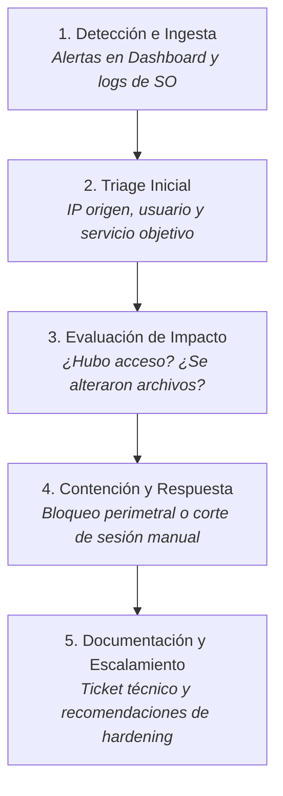

# Metodología de Monitoreo y Análisis SOC

Este documento define el marco analítico, el criterio de clasificación de severidades y el flujo de trabajo aplicado en **Wazuh-SOC-Lab**, orientado a un perfil **Blue Team / SOC Tier 1**.

---

## 1. Criterios de Severidad Técnica

Para evitar la fatiga de alertas y priorizar la respuesta defensiva, los eventos se clasifican según el impacto real confirmado sobre la tríada CIA (Confidencialidad, Integridad, Disponibilidad):

| Severidad | Criterio Operativo | Ejemplo en el Laboratorio | Acción Requerida |
|---|---|---|---|
| **Baja** | Escaneos de reconocimiento, intentos de fuerza bruta contenidos automáticamente por el host sin acceso exitoso ni alteración de datos. | [Caso 01: Escaneo Web y SSH](../../casos/caso-01-actividad-sospechosa/README.md) | Validar la eficacia del bloqueo, verificar ausencia de anomalías posteriores y cerrar el ticket sin escalamiento. |
| **Media** | Configuraciones riesgosas detectadas por auditoría (SCA) o modificaciones aisladas en archivos de sistema que requieren validación de cambios legítimos. | [Lab 02 (FIM)](../../labs/02-monitoreo-integridad-archivos/README.md) / [Lab 03 (SCA)](../../labs/03-evaluacion-configuracion-seguridad/README.md) | Analizar la causa raíz, coordinar la remediación técnica del control o ajustar la regla para evitar falsos positivos. |
| **Alta** | Acceso no autorizado confirmado con credenciales válidas, ejecución indebida de comandos con privilegios (`sudo`) o lectura de archivos sensibles (`/etc/shadow`). | [Caso 02: Acceso Indebido y Sudo](../../casos/caso-02-incidente-seguridad/README.md) | Contención inmediata: terminación forzada de sesiones, bloqueo de cuentas afectadas, auditoría de integridad y escalamiento formal. |
| **Crítica** | Compromiso integral del servidor, persistencia activa no contenida o pérdida total de disponibilidad operativa del endpoint. | N/A (Escenario de contingencia) | Aislamiento de red inmediato del equipo y activación del equipo de respuesta a incidentes (IR). |

---

## 2. Flujo de Triage e Investigación de Alertas

El análisis de cada alerta sigue un ciclo estándar de 5 etapas:

### 1. Detección e Ingesta
Monitoreo continuo de las alertas visualizadas en el Wazuh Dashboard y correlación cruzada con los registros directos del sistema operativo (`/var/log/auth.log`, `syslog`, `access.log` y canal *Security* de Windows).

### 2. Triage Inicial
Identificación de los vectores del evento:
- Dirección IP de origen (interna de laboratorio o no habitual).
- Cuenta de usuario afectada (existente vs. inexistente).
- Servicio expuesto bajo ataque (SSH, Apache, Servicios de red de Windows).

### 3. Evaluación de Impacto
Verificación analítica de consecuencias reales:
- ¿El intento fue bloqueado o existió autenticación exitosa?
- ¿Se invocaron privilegios elevados (`sudo`, pertenencia al grupo Administradores)?
- ¿Se alteraron archivos de configuración o se crearon puertas traseras (validado con FIM)?

### 4. Contención
- **Contención Automática**: Activación de defensas perimetrales del host (Fail2ban aplicando reglas en `iptables`).
- **Contención Manual en Caliente**: En incidentes con acceso confirmado, terminación de procesos de la sesión activa (`pkill -9`) y bloqueo de la cuenta a nivel de sistema operativo (`passwd -l`).

### 5. Documentación y Escalamiento
Al tratarse de un entorno de laboratorio individual, el "escalamiento" se aborda como la **elaboración de un informe técnico formal para Administración de Sistemas (Sysadmin) o Tier 2**:
- Resumen ejecutivo del incidente y cronología (*timeline*).
- Acciones de contención inmediata ya ejecutadas.
- Recomendaciones estructurales para erradicar la causa raíz (ej. forzar autenticación por llave pública en SSH, restringir permisos en `sudoers`).

---

## Documentos Relacionados

- Laboratorio de fuerza bruta y correlación: [Laboratorio 01 - Fuerza Bruta SSH](../../labs/01-fuerza-bruta-ssh/README.md).
- Casos prácticos de investigación: [Casos de Seguridad](../../casos/caso-01-actividad-sospechosa/README.md).
