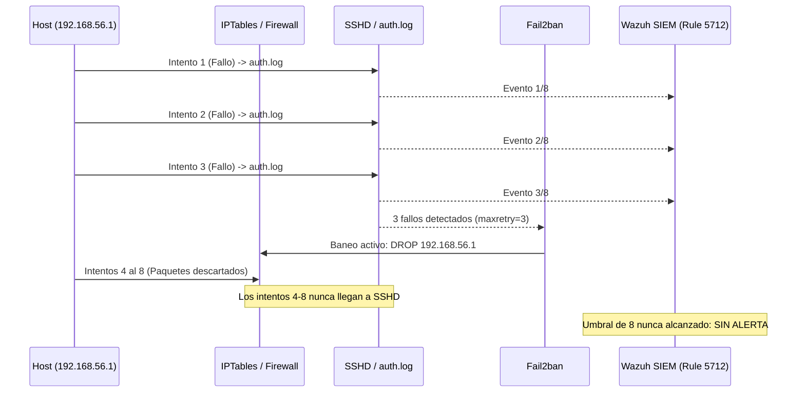

# Laboratorio 01: Fuerza Bruta SSH, Fail2ban y Análisis de Detección

## Objetivo

Simular un ataque de fuerza bruta contra el servicio SSH de un servidor Linux, analizar el comportamiento de las herramientas defensivas locales (**Fail2ban**), comprender el impacto en los registros de autenticación (`/var/log/auth.log`) y analizar la brecha de visibilidad (*visibility gap*) que se genera en el SIEM (**Wazuh**) cuando una herramienta de contención perimetral actúa antes de que se cumpla la ventana de correlación por defecto.

---

## Entorno del Laboratorio

- **Servidor Objetivo**: Ubuntu Server 22.04 LTS (registrado como `atacante-server` en `192.168.56.102`).
- **Origen de la Simulación**: Máquina física Windows (`192.168.56.1`) a través de la red Host-only.
- **Herramientas de Monitoreo y Defensa**: OpenSSH Server (`sshd`), Fail2ban y Wazuh 4.7.5.

---

## Procedimiento de Prueba

### 1. Simulación del ataque de fuerza bruta
Desde el host físico se ejecutó una simulación controlada de intentos continuos de inicio de sesión fallidos contra la cuenta `root` en la VM de Linux:

```bash
# Simulación con Hydra utilizando un diccionario de prueba
hydra -l root -P common_passwords.txt -t 4 -vV ssh://192.168.56.102
```

*Alternativa mediante bucle simple en terminal:*
```bash
for pass in 123456 password admin123 toor qwerty; do
  ssh -o StrictHostKeyChecking=no -o ConnectTimeout=2 root@192.168.56.102 "exit"
done
```

### 2. Inspección de registros en el servidor (`auth.log`)
En la máquina virtual objetivo se monitorearon los eventos de autenticación en tiempo real:

```bash
sudo tail -f /var/log/auth.log | grep -E "Failed password|sshd"
```

Los registros reflejaron inmediatamente los intentos erróneos provenientes de la dirección IP del host atacante:

```text
Oct 12 01:14:20 atacante-server sshd[2841]: Failed password for root from 192.168.56.1 port 54820 ssh2
Oct 12 01:14:22 atacante-server sshd[2843]: Failed password for root from 192.168.56.1 port 54822 ssh2
Oct 12 01:14:24 atacante-server sshd[2845]: Failed password for root from 192.168.56.1 port 54824 ssh2
```

### 3. Respuesta automática de Fail2ban
De acuerdo a la configuración local en `/etc/fail2ban/jail.local` ([jail.local](jail.local)), el parámetro `maxretry` está fijado en 3 intentos:

```bash
# Verificación del estado de la jaula SSH
sudo fail2ban-client status sshd
```

Salida del comando en la VM:
```text
Status for the jail: sshd
|- Filter
|  |- Currently failed: 0
|  `- Total failed:     3
`- Actions
   |- Currently banned: 1
   `- Banned IP list:   192.168.56.1
```

Fail2ban detectó el tercer fallo y de inmediato insertó una regla en el firewall local del host (`iptables` en la cadena `f2b-sshd`), descartando todos los paquetes posteriores procedentes de la IP `192.168.56.1`.

---

## Análisis de Visibilidad en el SIEM: El "Visibility Gap"

### El problema observado
Tras comprobar que Fail2ban bloqueó la conexión de manera efectiva, se consultó el **Wazuh Dashboard** para verificar las alertas de fuerza bruta SSH. Sin embargo, **el SIEM no generó ninguna alerta de fuerza bruta**.

### Causa raíz técnica
Analizando la interacción entre ambas herramientas defensivas, se identificó un problema clásico de arquitectura SOC (*Defense-in-Depth vs. SIEM Visibility*):

1. **La regla nativa de Wazuh exige un umbral mayor:**  
   La regla integrada de Wazuh para fuerza bruta SSH (`Rule 5712`) requiere una frecuencia de **8 intentos fallidos dentro de una ventana de 120 segundos**.
2. **Fail2ban corta el tráfico antes del umbral:**  
   Como Fail2ban tiene un límite estricto de `maxretry = 3`, al registrar el 3.er fallo cortó el tráfico a nivel de red con `iptables`. Los intentos subsecuentes (del 4 al 8) fueron descartados por el firewall del kernel antes de alcanzar el demonio `sshd`.
3. **Resultado en los logs:**  
   Al no llegar los paquetes a SSH, no se escribieron más líneas en `/var/log/auth.log`. El agente de Wazuh transmitió únicamente 3 eventos al Manager, número insuficiente para alcanzar los 8 requeridos por la regla 5712.



---

## Solución Propuesta: Regla Custom (`local_rules.xml`)

Para cerrar esta brecha y permitir que el SIEM detecte la ráfaga de fuerza bruta antes o al momento en que actúa la defensa perimetral, se diseñó la regla custom `100001` en [local_rules.xml](local_rules.xml):

```xml
<group name="custom_ssh,syslog,">
  <!-- Regla 100001: Correlación por IP adaptada al umbral de Fail2ban -->
  <rule id="100001" level="10" frequency="3" timeframe="120">
    <if_matched_sid>5716, 5710</if_matched_sid>
    <same_source_ip />
    <description>Fuerza bruta SSH detectada desde la misma IP (umbral lab ajustado a maxretry de Fail2ban)</description>
    <mitre>
      <id>T1110.001</id>
    </mitre>
  </rule>
</group>
```

### Justificación de los parámetros:
- **`frequency="3"`**: Se alinea exactamente con el `maxretry = 3` de Fail2ban, permitiendo que el SIEM dispare la alerta en el tercer evento fallido, justo antes de que el firewall corte la comunicación.
- **`<if_matched_sid>5716, 5710</if_matched_sid>`**: Evalúa tanto autenticaciones fallidas de cuentas existentes como `root` (Rule 5716) como de cuentas inexistentes o inválidas (Rule 5710), evitando puntos ciegos si el atacante alterna entre nombres de usuario.
- **`<same_source_ip />`**: Garantiza que los 3 eventos provengan de la misma dirección IP de origen dentro de la ventana de 120 segundos.

---

## Alcance y Limitaciones del Laboratorio

- **Inspección a nivel de host:** La detección, trazabilidad y contención de la fuerza bruta fueron validadas y comprobadas directamente en los logs del sistema operativo (`/var/log/auth.log`) y en el estado de Fail2ban (`fail2ban-client`).
- **Limitación en el SIEM:** En la configuración estándar de Wazuh con su regla nativa 5712, no se generaron alertas en el Dashboard para este escenario debido a que Fail2ban aisló la conexión antes de alcanzar el umbral de 8 eventos.
- **Lección aprendida para entornos de producción:** Una herramienta de prevención local (IPS/Fail2ban) no debe operar aislada del SIEM. Para tener visibilidad completa en producción, se recomienda:
  1. Ajustar los umbrales de correlación de fuerza bruta en el SIEM para que sean menores o iguales al `maxretry` del IPS.
  2. Ingestar el log de la herramienta de contención (`/var/log/fail2ban.log`) mediante directivas `<localfile>` en el agente de Wazuh, correlacionando el evento de bloqueo (`Ban`) como una alerta de contención automática.

---

## Archivos de este Laboratorio

- [local_rules.xml](local_rules.xml): Regla XML propuesta para el Manager que correlaciona ráfagas SSH con umbral ajustado a 3 intentos.
- [jail.local](jail.local): Configuración aplicada en `/etc/fail2ban/jail.local` para proteger el servicio OpenSSH.

---

## Documentos Relacionados

- Aplicación de este escenario en un ticket de investigación: [Caso 01 - Actividad Sospechosa Contenida](../../casos/caso-01-actividad-sospechosa/README.md).
- Siguiente laboratorio: [Laboratorio 02 - Monitoreo de Integridad de Archivos (FIM)](../02-monitoreo-integridad-archivos/README.md).
