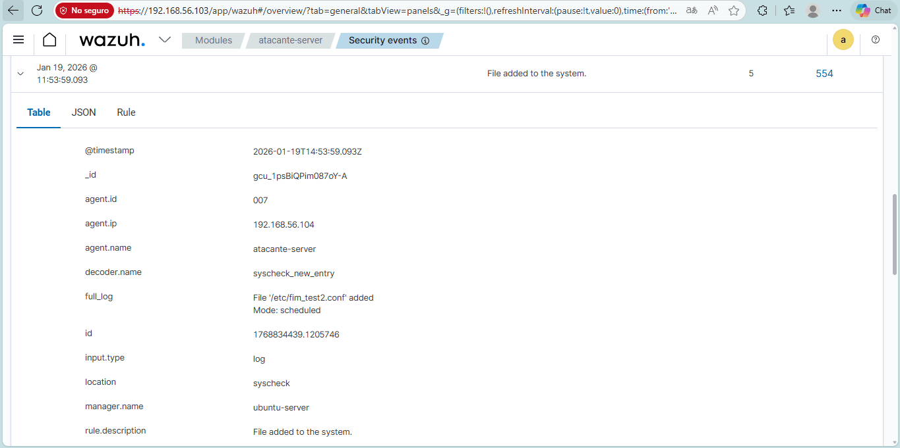
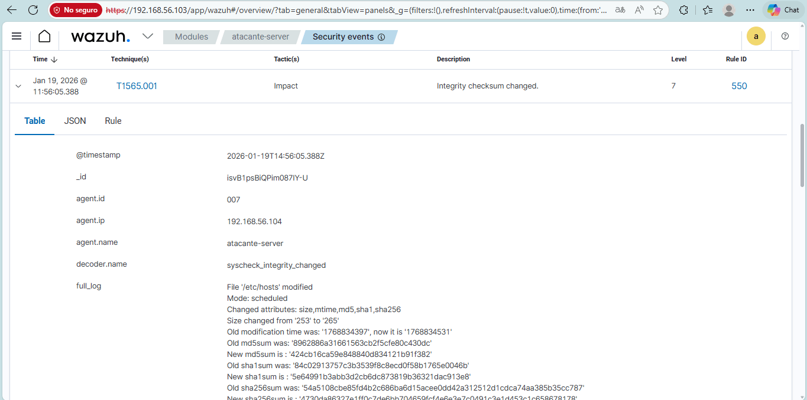

# Laboratorio 02: Monitoreo de Integridad de Archivos (FIM / syscheck)

## Objetivo

Implementar y validar el módulo **File Integrity Monitoring (FIM / syscheck)** de Wazuh para supervisar directorios críticos del sistema (`/etc`), detectando en tiempo real y de forma programada la creación de archivos nuevos o la modificación de configuraciones esenciales.

---

## Entorno del Laboratorio

- **Endpoint monitoreado**: Ubuntu Server 22.04 LTS (registrado como `atacante-server`).
  > *Nota sobre la evidencia:* En las capturas recolectadas para este módulo, el agente quedó registrado con ID `007` e IP `192.168.56.104`, reportando al Wazuh Manager en `192.168.56.103`.
- **Ruta auditada**: `/etc` (archivos de configuración y servicios del sistema).
- **Mecanismos evaluados**: Detección programada (`scheduled`) y optimización en tiempo real con `inotify` (`realtime="yes"`).
- **Plataforma SIEM**: Wazuh 4.7.5.

---

## Procedimiento de Prueba

### 1. Generación de eventos en el servidor Linux
Para evaluar la respuesta del motor `syscheck`, se realizaron dos operaciones directas en la terminal de la VM:

#### A. Creación de un archivo nuevo de prueba
Simulando el depósito de un archivo de configuración o script anómalo:
```bash
sudo touch /etc/fim_test2.conf
echo "TEST_CONFIG=ACTIVE" | sudo tee -a /etc/fim_test2.conf
```

#### B. Modificación de un archivo crítico existente
Simulando una alteración en la resolución local de nombres:
```bash
echo "# Modificacion de prueba en laboratorio" | sudo tee -a /etc/hosts
```

---

## Análisis de Modos de Monitoreo: Programado vs. Tiempo Real

Al realizar las pruebas iniciales, el agente operaba con la directiva por defecto de `syscheck`:
```xml
<frequency>43200</frequency>
```
Bajo esta configuración, las alertas se generan mediante un barrido programado que compara los atributos del archivo contra la base de datos interna de Wazuh. Por esta razón, en las evidencias capturadas en el Dashboard se observa:
- **`Mode: scheduled`** en ambas alertas.
- Los atributos alterados en `/etc/hosts` incluyeron: `size`, `mtime`, `md5`, `sha1` y `sha256`.

### Optimización en tiempo real (`ossec-fim-snippet.conf`)
Para que un analista SOC no deba esperar el intervalo de escaneo periódico (que por defecto es de 12 horas) y reciba la alerta al instante, se actualizó la configuración en `/var/ossec/etc/ossec.conf` ([ossec-fim-snippet.conf](ossec-fim-snippet.conf)):

```xml
<!-- Monitoreo en tiempo real de /etc vía inotify del kernel -->
<directories check_all="yes" realtime="yes">/etc</directories>

<!-- Diffs de contenido restringidos a archivos de configuración no sensibles -->
<directories check_all="yes" report_changes="yes">/etc/issue.net,/etc/hosts,/etc/ssh/sshd_config</directories>

<!-- SEGURIDAD CRÍTICA: Evitar volcado de diffs en /etc/shadow -->
<nodiff>/etc/shadow</nodiff>
```

### Consideración de Seguridad: Protección de `/etc/shadow` con `nodiff`
La directiva `report_changes="yes"` envía el diff textual con los cambios aplicados en el archivo directamente al Wazuh Manager (almacenándose en `/var/ossec/queue/diff/`).  
**Antipatrón en producción:** Si se aplica `report_changes` a todo `/etc` sin restricciones, cualquier cambio de contraseña provocará que los hashes de `/etc/shadow` viajen y se indexen en texto claro en el SIEM.  
**Solución aplicada:** Se utiliza la directiva explícita `<nodiff>/etc/shadow</nodiff>` y se limita `report_changes` únicamente a archivos que no contienen secretos (`/etc/hosts`, `/etc/issue.net`, `/etc/ssh/sshd_config`).

---

## Alertas Detectadas en el Dashboard

| Evento | Regla Wazuh | Nivel | Modo | Archivo Afectado | Relevancia en Seguridad |
|---|---|---|---|---|---|
| **File added to the system** | `Rule 554` | Nivel 5 | `scheduled` | `/etc/fim_test2.conf` | Detección temprana de persistencia, herramientas de ataque o binarios depositados en directorios del sistema. |
| **Integrity checksum changed** | `Rule 550` | Nivel 7 | `scheduled` | `/etc/hosts` | Alerta sobre modificación de hashes (SHA256). Crítico para detectar redireccionamiento de tráfico o manipulación de resoluciones locales. |

---

## Evidencias Verificadas en el Dashboard

Capturas obtenidas directamente de la consola de Wazuh:

### 1. Alerta de archivo nuevo añadido (`File added to the system`)
Se valida la detección del archivo `/etc/fim_test2.conf` con regla 554 en el agente `atacante-server`:



### 2. Alerta de modificación de integridad (`Integrity checksum changed`)
Se valida la modificación en `/etc/hosts` con regla 550, detallando el recálculo de hashes (MD5, SHA1, SHA256) y variación de tamaño:



---

## Archivos de este Laboratorio

- [ossec-fim-snippet.conf](ossec-fim-snippet.conf): Configuración de `syscheck` con monitoreo en tiempo real vía `inotify`, filtrado de rutas y protección de contraseñas con `nodiff`.

---

## Documentos Relacionados

- Laboratorio anterior: [Laboratorio 01 - Fuerza Bruta SSH y Fail2ban](../01-fuerza-bruta-ssh/README.md).
- Siguiente laboratorio: [Laboratorio 03 - Evaluación de Configuración de Seguridad (SCA)](../03-evaluacion-configuracion-seguridad/README.md).
