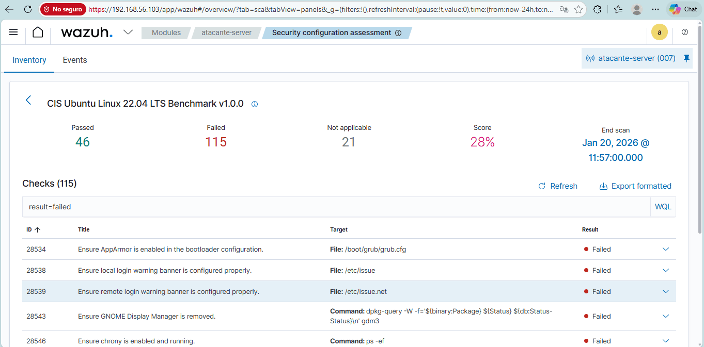
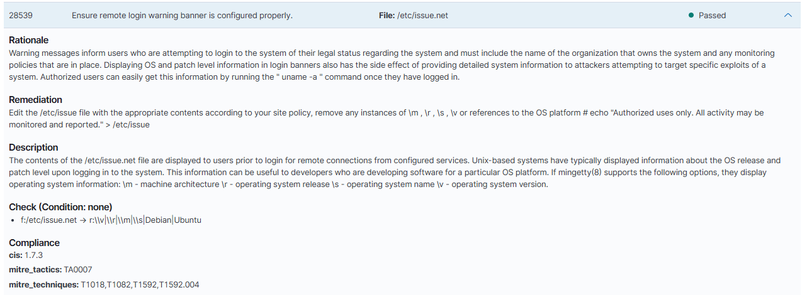
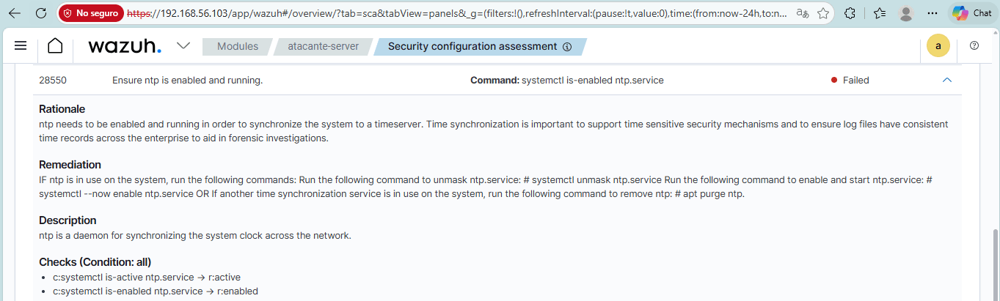
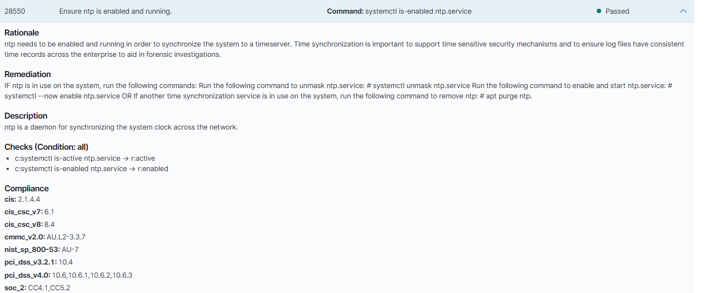

# Laboratorio 03: Auditoría de Seguridad (SCA) y Hardening

## Objetivo

Utilizar el módulo **Security Configuration Assessment (SCA)** de Wazuh para auditar la postura de seguridad de un sistema Linux mediante políticas basadas en benchmarks de buenas prácticas (**CIS Benchmarks**), detectar configuraciones débiles o riesgosas, aplicar remediaciones técnicas de *hardening* a nivel de sistema operativo y verificar en el Dashboard su cambio de estado a cumplimiento (`PASSED`).

---

## Entorno del Laboratorio

- **Endpoint auditado**: Ubuntu Server 22.04 LTS (Agente Linux `atacante-server`).
- **Política evaluada**: CIS Ubuntu Linux Benchmark.
- **Plataforma SIEM**: Wazuh 4.7.5.

---

## Controles Seleccionados y Remediación Técnica

Durante el escaneo inicial de SCA se identificaron diversos controles en estado **FAILED**. Para este laboratorio se priorizaron dos puntos fundamentales para la operación de un SOC:

---

### 1. Sincronización Horaria con NTP

- **Control CIS**: `Ensure ntp is enabled and running` (Check ID: 28550)
- **Estado Inicial**: **FAILED** (El servidor no contaba con un demonio de sincronización activo).
- **Impacto en SOC**: La inconsistencia de tiempo entre endpoints imposibilita la correlación forense cronológica de logs y eventos de seguridad a través de la red.
- **Remediación técnica aplicada**:
  ```bash
  # Instalación y activación del servicio de sincronización NTP
  sudo apt-get update
  sudo apt-get install -y ntp
  sudo systemctl enable ntp
  sudo systemctl start ntp

  # Verificación de conectividad con servidores de tiempo
  ntpq -p
  ```
- **Resultado en Dashboard**: El control pasó de forma verificada a estado **PASSED**.

---

### 2. Banner de Advertencia de Acceso Remoto (`/etc/issue.net`)

- **Control CIS**: `Ensure remote login warning banner is configured properly` (Check ID: 28539)
- **Estado Inicial**: **FAILED** (El archivo por defecto exponía el nombre y versión de la distribución Linux, lo que facilita el reconocimiento a atacantes para seleccionar exploits).
- **Remediación técnica aplicada**:
  Se sustituyó el contenido de `/etc/issue.net` por un aviso legal genérico sin información del sistema operativo ([issue.net](issue.net)):
  ```bash
  # Copia y permisos del banner neutral remediado
  sudo cp issue.net /etc/issue.net
  sudo chown root:root /etc/issue.net
  sudo chmod 644 /etc/issue.net
  ```
- **Resultado en Dashboard**: El control pasó formalmente a estado **PASSED**.

---

### 3. Forzar Reevaluación del Módulo SCA

Para evitar esperar el intervalo programado del escaneo de políticas, se reinició el agente en la máquina virtual para enviar el informe actualizado de inmediato al Wazuh Manager:

```bash
sudo systemctl restart wazuh-agent
```

---

## Evidencias Verificadas en el Dashboard

Capturas obtenidas en el Wazuh Dashboard que respaldan el ciclo de remediación:

### Control: Banner de Acceso Remoto (`/etc/issue.net`)
- **Estado inicial con fallo (`Ensure remote login FAILED`)**:
  
  

- **Verificación remediada (`Ensure remote login PASSED`)**:
  
  

### Control: Sincronización NTP
- **Estado inicial con fallo (`Enable ntp FAILED`)**:
  
  

- **Servicio activo y verificado (`Enable ntp PASSED`)**:
  
  

---

## Archivos de este Laboratorio

- [issue.net](issue.net): Banner neutral de advertencia legal utilizado para cumplir con el control CIS en `/etc/issue.net`.

---

## Documentos Relacionados

- Laboratorio anterior: [Laboratorio 02 - Monitoreo de Integridad de Archivos (FIM)](../02-monitoreo-integridad-archivos/README.md).
- Siguiente laboratorio: [Laboratorio 04 - Monitoreo de Eventos en Linux y Windows](../04-monitoreo-linux-windows/README.md).
