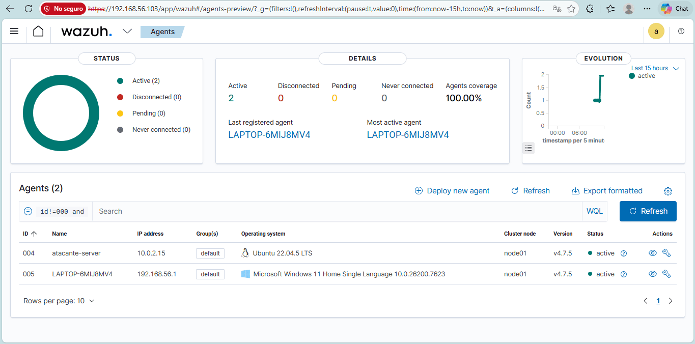
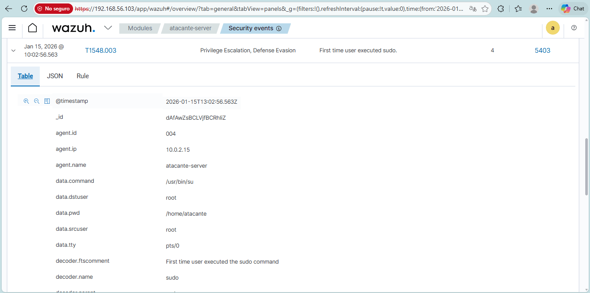
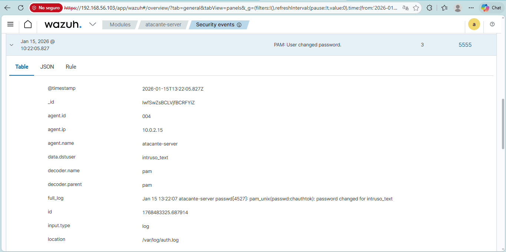
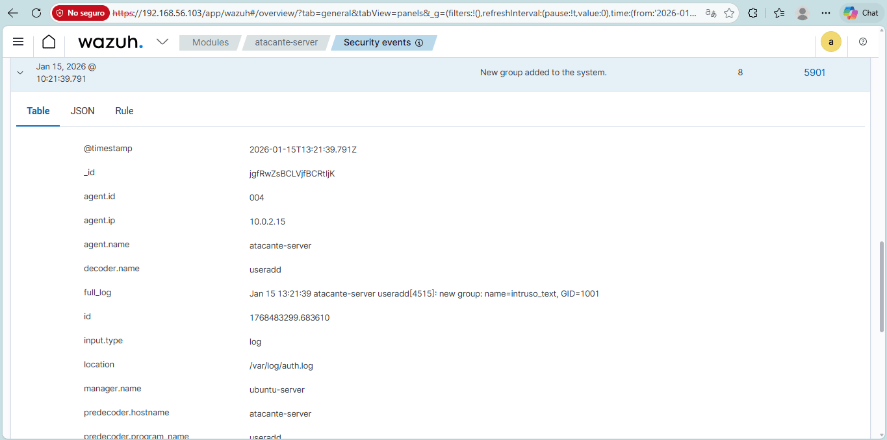
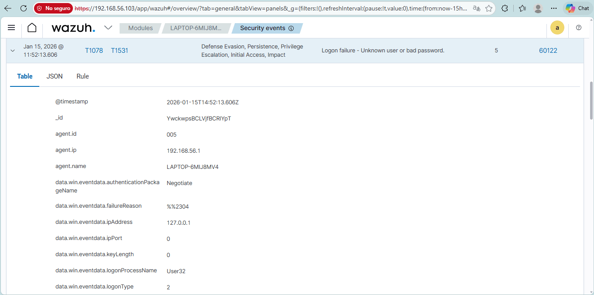
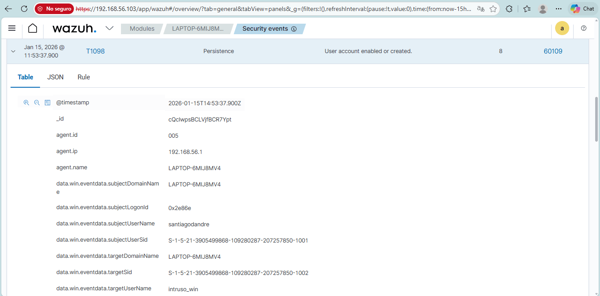
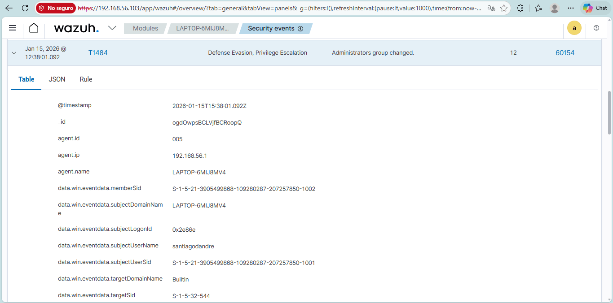

# Laboratorio 04: Monitoreo de Eventos en Entornos Heterogéneos (Linux y Windows)

## Objetivo

Comprobar la capacidad de ingesta, decodificación y correlación centralizada de eventos de seguridad en **Wazuh** sobre un entorno heterogéneo (Linux y Windows), analizando eventos críticos vinculados con autenticación, gestión de identidades y elevación de privilegios.

---

## Entorno del Laboratorio

- **Servidor Wazuh**: Ubuntu Server (Wazuh Manager, Indexer y Dashboard v4.7.5).
- **Agente Linux**: Ubuntu Server 22.04 LTS (registrado como `atacante-server`).
- **Agente Windows**: Endpoint Windows físico (registrado como `LAPTOP-6MIJ8MV4`), monitoreando eventos nativos del canal *Security*.
- Para detalles sobre la conectividad, consultar [Arquitectura](../../docs/arquitectura/README.md).

---

## Comandos y Simulación de Eventos

Para generar telemetría real y validar la activación de reglas nativas, se realizaron las siguientes pruebas en cada sistema:

### 1. Sistema Linux (Ubuntu Server)

```bash
# Prueba 1: Creación de usuario y primer uso del comando sudo (MITRE T1548.003)
# Al ejecutar 'useradd intruso_text', el sistema crea el usuario y su grupo correspondiente:
sudo useradd -m -s /bin/bash intruso_text

# Prueba 2: Modificación de contraseña de cuenta local (MITRE T1098)
sudo passwd intruso_text

# Prueba 3: Primera invocación de privilegios administrativos
# Genera la alerta de primer uso de comando privilegiado:
sudo su
```

### 2. Sistema Windows (PowerShell / Consola Administrativa)

```powershell
# Prueba 1: Generar intento fallido de autenticación interactiva - Event ID 4625 (MITRE T1110)
# Intentos con credenciales incorrectas en la pantalla de bloqueo o consola

# Prueba 2: Creación de cuenta de usuario local - Event ID 4720 (MITRE T1136.001)
net user intruso_win ClaveSegura2024! /add

# Prueba 3: Incorporación de usuario al grupo Administradores - Event ID 4728/4732 (MITRE T1098)
net localgroup Administradores intruso_win /add
```

---

## Alertas y Reglas Validadas en el Dashboard

A continuación se detallan las alertas verificadas en la consola de Wazuh, coincidentes con las capturas de pantalla obtenidas durante la auditoría:

### 1. Eventos en Linux (Ubuntu Server)

| Alerta en Dashboard | Regla Wazuh | Nivel | Detalles Observados en Log | Relevancia en Seguridad |
|---|---|---|---|---|
| **First time user executed sudo** | `Rule 5403` | Nivel 4 | Invocación de `/usr/bin/su` por el usuario `atacante`. | Indicador de primer uso de privilegios administrativos o posible escalada. |
| **PAM: User changed password** | `Rule 5555` | Nivel 3 | Cambio de token de autenticación para la cuenta `intruso_text`. | Registro de alteración de credenciales en `/etc/shadow`. |
| **New group added to the system** | `Rule 5901` | Nivel 8 | Alta del grupo `intruso_text` (GID 1001) mediante `useradd`. | Modificación en la estructura de grupos locales y accesos del sistema. |

### 2. Eventos en Windows (Host)

| Alerta en Dashboard | Event ID | Regla Wazuh | Nivel | Detalles Observados en Log | Relevancia en Seguridad |
|---|---|---|---|---|---|
| **Logon failure - Unknown user or bad password** | `4625` | `Rule 60122` | Nivel 5 | Intento interactivo fallido (`LogonType: 2`, `User32`) desde `127.0.0.1`. | Detección de fallos reiterados o intentos de adivinación de contraseñas. |
| **User account enabled or created** | `4720` | `Rule 60109` | Nivel 8 | Creación de la cuenta local `intruso_win` por el usuario `santiagodandre`. | Técnica clásica para establecer persistencia secundaria en el host. |
| **Administrators group changed** | `4728 / 4732` | `Rule 60154` | Nivel 12 | Inclusión del miembro `intruso_win` en el grupo local `Administradores`. | Elevación de privilegios a nivel administrativo total sobre el equipo. |

---

## Evidencias Verificadas en el Dashboard

Capturas de pantalla obtenidas en el Wazuh Dashboard que respaldan cada evento:

### Estado de Agentes
- **Ambos agentes activos y reportando simultáneamente (`Lab agents`)**:
  
  

### Alertas en Linux
- **Primer uso de sudo (`Linux first time sudo alert`)**:
  
  

- **Cambio de contraseña (`Linux change password alert`)**:
  
  

- **Nuevo grupo añadido (`Linux new group added alert`)**:
  
  

### Alertas en Windows
- **Inicio de sesión fallido (`Win failed logon`)**:
  
  

- **Creación de usuario local (`Win user created`)**:
  
  

- **Modificación del grupo Administradores (`Win admin group changed`)**:
  
  

---

## Documentos Relacionados

- Laboratorio anterior: [Laboratorio 03 - Evaluación de Configuración de Seguridad (SCA)](../03-evaluacion-configuracion-seguridad/README.md).
- Casos prácticos de investigación: [Casos de Seguridad](../../casos/caso-01-actividad-sospechosa/README.md).
